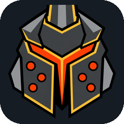

<h1 align="center">Dauntless Forever</h1>

<b>Play Dauntless again: solo, with friends, or in a shared world that never goes down.</b> 
No keys, no accounts to buy, no paid advantages. A free fan preservation project.

  <a href="https://github.com/addison2k/DauntlessForever/releases/latest"><b>Download the latest launcher</b></a> &nbsp;|&nbsp;
  <a href="https://discord.gg/sg9J7KshVc"><b>Join the Discord</b></a>

---

## What it does

One launcher that downloads an old Dauntless build from Epic's own servers, sets it up by itself and lets you play it,
offline or online with other people. No game files are shipped here; the game comes straight from Epic.

| Build | Era | Status |
|---|---|---|
| **1.6.2** | Reforged (early 2021) | **Ready**: solo, online and Host Mode. The most stable. |
| **1.14.7** | Last pre-Awakening build (April 2024) | **Ready**: solo, online, Host Mode and **Forever Beta**. The most content. |
| 1.12.0 | Late Reforged (October 2022) | Coming soon |
| 2.1.1 | Awakening (December 2024) | Coming soon |

Pick either of the ready builds, or install both. They keep separate characters and separate settings, and you can
copy a Slayer between them whenever you like.

---

## Forever Beta

A shared, always-on Dauntless world on 1.14.7. Open the launcher, press Play, and you are in a Ramsgate with
everyone else. No hosting, no waiting for a friend to come online, nothing to set up.

**Your Slayer lives on the server.** Not in a file on your PC. Nothing to back up, nothing to lose, and you can play
from any PC you install the launcher on. It is a fresh Slayer: your solo and Host Mode characters stay exactly as
they are and are never touched.

**The town stays open.** Ramsgate keeps running when you close the game, with the other players still in it. Come
back an hour later and it is where you left it.

**Pick your region.** North America, Europe, Australia, or Any for whichever is busiest right now. Each region has
its own Ramsgate, and the launcher shows your ping to each one before you choose. You can change region whenever.

**Hunts run on players' PCs.** Not on one big rented box. The launcher measures your connection and your PC once,
and machines with room to spare quietly host hunts for everyone. That is the whole reason this costs nothing to
play: there is no server bill that scales with the number of people in it. If your PC hosts a hunt, you will not
notice; if it is busy or short on memory, it will not be asked.

**Still no port forwarding.** Nothing to change on your router, ever, whether you are hosting a hunt or joining one.

It is a beta, it is worked on daily, and things do break. When they do, see "If something goes wrong" below. Problem
reports with logs attached are what fixes the beta, and most of what has been fixed so far came from one.

---

## Play with friends

- **Friends panel**: add friends by name (or `name#1234`), see who is online, playing or hosting, press **Join**.
- **Host with friends**: one click opens your game to your friends through the Dauntless Forever relays
  (US East, US Central, Europe, Australia and Japan; the nearest is picked for you). No router settings,
  nothing to install.
- **Play online**: joins a game that is open to everyone, or hosts one if nobody is on. **Allow randoms** opens your
  own hosted game to Play online players.
- **Your character comes with you** when you join someone, and is saved home every few minutes while you play.
- **Parties**: invite, party hunts, Return with Party.
- **Chat**: text chat in game, and voice chat in the launcher (push to talk or voice activation).
- Hosted games always use normal progression, so everyone levels up the same way.

## Host Mode

Keep a server running on your PC: a Ramsgate that players join from their launcher, party up in and start hunts
from. No game window needed; press **Play on your server** to join it yourself.

- **Private** (your friends list is the whitelist) or **Public** (anyone using Play online).
- Server name, a welcome line in game chat, a player limit and a ban list.
- For a PC that hosts all day, each one an option: start with Windows, restart by itself, keep the PC awake,
  a daily restart and a daily save backup.
- A small dashboard shows players, hunts, uptime and the PC's load.

Each hunt that runs on your server needs roughly 3 GB of memory on top of the town. On a PC with 16 GB that is
usually one hunt at a time, and the launcher tells players to party up rather than failing quietly.

## Make it yours

- **Game Rules**: weapon XP and Hunt Pass speed, loot amounts, free crafting and more. Multipliers go up to 5x.
  Your server, your rules; they apply to everyone playing on it.
- **Seasons**: 36 Hunt Passes to pick from, including a 400-level Mega pass.
- **Events**: Ramsgate event decorations.
- **Inventory**: change currencies and tokens, add or remove gear.
- **Slayer copy**: move a character between 1.6.2 and 1.14.7, either direction. The copy it reads from is left alone.
- **Mods**: 1.14.7 supports UE4SS Lua mods from the Mods tab. Turn mods on, drop them in, done.
- **Bring your Dauntless Revived (1.4.4) character**: More > "Bring my Dauntless Revived (1.4.4) character" moves
  your gear, Rams, cells, materials and quest progress into 1.6.2. Your Revived save is only read, never changed.
- **Play offline**: play only on your PC, with nobody able to see you online.

Planning a build? There is a build planner at [builder.dauntlessforever.com](https://builder.dauntlessforever.com)
for 1.6.2 and 1.14.7: weapons, armour, lanterns, cells and perks, shareable with a build code.

---

## Getting started

1. Download `DauntlessForever-<version>-x64.exe` (installer) or the `.zip` (unzip anywhere) from
   [Releases](https://github.com/addison2k/DauntlessForever/releases/latest) and run it.
2. Pick your player name. One name for every build and for your friends list.
3. Pick a build at the top and press **Download**: about 11 to 15 GB, straight from Epic. Set-up runs by itself
   afterwards, then the button turns into **Play**.

Already have the game folder from somewhere else? More > "Use a game folder I already have".

For **Forever Beta**: install 1.14.7, open the **Forever** tab, pick a region, rate your PC once when it asks, and
press **Play Forever**.

**Needs**: Windows 10 or 11 (64-bit), and free space for the game, about twice its size while it downloads.
Node.js, DirectX and the Visual C++ runtime are included or installed by set-up.

**Updates** arrive by themselves. Server files download when you open the launcher; when a new launcher is out you
get a banner with a Download button. A launcher update needs two restarts: one to fetch it, one to use it.

**Where things are**: `%LOCALAPPDATA%\DauntlessForever\` (`DauntlessOffline\` for players from before the rename),
one folder per build under `versions\<id>\`. `data\` holds your save, `backup\` holds its older copies, and
`upload\` holds the log zips for asking for help. Nothing is written into your Windows Dauntless settings, and
uninstalling the launcher leaves that folder alone.

---

## If something goes wrong

Most problems have a one-click fix in the launcher's **More** menu. In rough order of how often they come up:

**The game will not start, or starts and closes.** Nine times out of ten this is antivirus. The game server is a
modified Dauntless, which is exactly what antivirus guesswork is built to dislike, and several of them quietly
delete launcher files. More > **"Allow in the antivirus"** adds the exclusions for Windows Defender in one click and
shows you what to add for anything else. Then More > **"Repair the launcher files"** puts back whatever was removed.
Avast, Bitdefender, Kaspersky, Norton and Panda have all done this to someone.

**"The join proxy did not start", "Error 1", or the game will not launch after you played earlier.** Something from
the last session is still holding its ports. More > **"Close anything Forever left running"**, then press Play.
Restarting the PC does the same thing.

**Stuck on an infinite loading screen.** Same fix as above. If it still hangs, send logs.

**Resolution is stuck smaller than your monitor.** That is Windows display scaling, not the game: at 125% scaling
the game is offered 1536x864 instead of 1920x1080. Right-click `Dauntless-Win64-Shipping.exe` in
`Archon\Binaries\Win64`, Properties, Compatibility, "Change high DPI settings", tick "Override high DPI scaling
behaviour" and set it to **Application**.

**Your character looks wrong or missing in Forever Beta.** Forever characters live on the server, so they are
almost never actually gone. Usually the PC is signing in under a new id after a reinstall. Ask on the Discord with
your in-game name and it can be put back.

**Hunts take a long time to start, or you cannot leave Ramsgate.** Your PC may not have the memory free to run a
hunt. Closing a browser before you play is often enough. Otherwise party up with someone, since a party shares one
hunt.

**Want to start over?** Close everything, rename `versions\1.14.7` to `versions\1.14.7-backup`, and open the
launcher. It sets the build up again by itself and you make a new character. Nothing is downloaded again, and your
old character is still in that renamed folder if you want it back.

## Reporting a problem

More > **"Send my logs to the Dauntless Forever team"**, write a line about what happened, and you get a report
number. Post that number on the Discord.

The report contains the launcher and game server logs, what the game did in the seconds before it broke, and your
PC's specs. Your Windows user name, your PC name and your file paths are blanked out, and no save file or account
key is included. Nearly every fix in the beta so far started with one of these.

---

## Name, branding and artwork

The AGPL-3.0 licence covers the **code** in this repository. It does not grant any rights to the Dauntless Forever
name, logo, icons, artwork, UI design or any other branding, and no such rights are granted here. (AGPL-3.0
section 7 expressly allows declining to grant rights under trademark law, so this reservation takes nothing away
from your rights to the code.)

You are free to fork, change and redistribute this project under the AGPL. If you do, please:

- **Give your fork its own name.** Do not call it Dauntless Forever, do not use a name that could be mistaken for
  it, and do not use the logo, the launcher icon or the artwork.
- **Do not imply this project endorses yours**, or that yours is an official version, a successor, or run by the
  same people.
- **Do not use the dauntlessforever.com domain, the Discord, or any Dauntless Forever account names** to promote
  or distribute your fork.
- **Keep the credits.** The AGPL requires this anyway: the copyright notices at the top of each source file,
  NOTICE.txt, and the attributions to Undaunted, Dauntless Revived, MinHook and the other projects this is
  built on.

Code you add to a fork is yours and you may license your own additions as the AGPL allows, but the name and the
look are not part of what you receive.

---

## Credits and licences

- Built on [Undaunted](https://github.com/SyST3MDeV/Undaunted) by gwog and contributors (AGPL-3.0). The server DLLs,
  loaders and backends are modified versions, with full source in each package's `source\` and `backend\` folders.
- In-game chat server and parts of the party code from the Dauntless Revived project (AGPL-3.0), credited in those files.
- [MinHook](https://github.com/TsudaKageyu/minhook) (BSD-2) in the loaders, and
  [DauntlessEndpointDocumentation](https://github.com/EisigesEis/DauntlessEndpointDocumentation) for the backend work.
- Download tool: [meszmate/manifest](https://github.com/meszmate/manifest) (MIT), with the uncompressed-chunk fix from
  [DauntlessManifestArchive](https://github.com/addison2k/DauntlessManifestArchive).
- Bundled [Node.js](https://nodejs.org) (MIT); `ws` and `ltx` (MIT) in the 1.6.2 backend.
- Everyone on the Credits page in the launcher.
- Launcher: AGPL-3.0, Addison2k, 2026.

By contributing to this project you agree that your contribution may be distributed under AGPL-3.0-only, and that the project may also license it under other terms in future.

Dauntless belongs to its owners. This is an unofficial fan project, not affiliated with or endorsed by Phoenix Labs.
