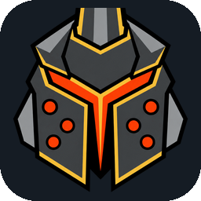

<p align="center"></p>

<h1 align="center">Dauntless Forever</h1>

<p align="center"><b>Play Dauntless again: solo or with friends, on the build you love.</b><br>
No keys, no accounts to buy, no paid advantages. A free fan preservation project.</p>

<p align="center">
  <a href="https://github.com/addison2k/DauntlessForever/releases/latest"><b>Download the latest launcher</b></a> &nbsp;|&nbsp;
  <a href="https://discord.gg/sg9J7KshVc"><b>Join the Discord</b></a>
</p>

---

## What it does

One launcher that downloads an old Dauntless build from Epic's own servers, sets it up by itself and lets you play it,
offline or online with other people. No game files are shipped here; the game comes straight from Epic.

| Build | Era | Status |
|---|---|---|
| **1.6.2** | Reforged (early 2021) | **Ready**: solo and online. The most complete. |
| **1.14.7** | Last pre-Awakening build (April 2024) | **Experimental**: solo |
| 1.12.0 | Late Reforged (October 2022) | Coming soon |
| 2.1.1 | Awakening (December 2024) | Coming soon |

### Play together, no port forwarding
- **Friends panel**: add friends by name (or `name#1234`), see who is online, playing or hosting, press **Join**.
- **Host with friends**: one click opens your game to your friends through the Dauntless Forever relay (US and EU,
  the nearest is picked for you). No router settings, nothing to install.
- **Play online**: joins a game that is open to everyone, or hosts one if nobody is on. **Allow randoms** opens your
  own hosted game to Play online players.
- **Your character comes with you** when you join someone, and is saved home every few minutes while you play.
- **Parties** (invite, party hunts, Return with Party), **text chat** in game and **voice chat** in the launcher
  (push to talk or voice activation).
- Hosted games always use normal progression, so everyone levels up the same way.

### Host Mode
Keep a server running on your PC: a Ramsgate that players join from their launcher, party up in and start hunts
from. No game window needed; press **Play on your server** to join it yourself.
- **Private** (your friends list is the whitelist) or **Public** (anyone using Play online).
- Server name, a welcome line in game chat, a player limit and a ban list.
- For a PC that hosts all day, each one an option: start with Windows, restart by itself, keep the PC awake,
  a daily restart and a daily save backup. A small dashboard shows players, hunts, uptime and the PC's load.

### Your way
- **Game Rules**: weapon XP and Hunt Pass speed, loot, free crafting.
- **Seasons**: 36 Hunt Passes to pick from, including a 400-level Mega pass.
- **Events**: Ramsgate event decorations.
- **Inventory**: change currencies and tokens, add or remove gear.
- **Bring your Dauntless Revived (1.4.4) character**: More > "Bring my Dauntless Revived (1.4.4) character" moves your
  gear, Rams, cells, materials and quest progress into 1.6.2. Your Revived save is only read.
- **Offline Forever mode**: play only on your PC, nobody sees you online.

## Getting started

1. Download `DauntlessForever-<version>-x64.exe` (installer) or the `.zip` (unzip anywhere) from
   [Releases](https://github.com/addison2k/DauntlessForever/releases/latest) and run it.
2. Pick your player name (one name for every build and for your friends).
3. Pick a build at the top, press **Download** (about 11-15 GB from Epic). Set-up runs by itself afterwards, then the
   button turns into **Play**.

Already have the game folder? More > "Use a game folder I already have".

**Needs**: Windows 10 or 11 (64-bit) and free space for the game (about twice its size while it downloads).
Node.js, DirectX and the Visual C++ runtime are included or installed by set-up.

**Updates** come by themselves: server files when you open the launcher, and a banner with a Download button when a
new launcher is out.

**Where things are**: `%LOCALAPPDATA%\DauntlessForever\` (`DauntlessOffline\` for players from before the rename),
one folder per build under `versions\<id>\`. `data\` is your save; `upload\` has the log zips for asking for help
(More > "Get the logs"; your PC and user names are blanked out). Nothing is written into your Windows Dauntless
settings, and uninstalling the launcher keeps that folder.

**Help**: the Help page in the launcher, or the [Discord](https://discord.gg/sg9J7KshVc).

---

## For developers

### Building

Needs Node.js 20+ and npm, on Windows for the installer.

```
npm install
npm start            # run from source
npm run dev          # mock mode (Linux/macOS shell): fake statuses and downloads, no PowerShell
npm run dist         # dist\DauntlessForever-<ver>-x64.exe (installer) and -x64.zip (portable)
npm run dist:dir     # dist\win-unpacked only (quick test build)
```

`predist` runs `tools/check-ascii.js` (the launcher's text must be plain ASCII) and `tools/fetch-node.ps1` (the bundled
official Node.js in `resources/runtime/node`).

### Layout

```
src/main/
  main.js        window + IPC (status, download, set-up, play, stop, uninstall, Revived import)
  versions.js    reads resources/versions/*/version.json; copies each package to the data folder without
                 touching saves; status = exe hash + installed DLL hashes + set-up marker files
  runner.js      runs the package scripts (set-up in a window, play hidden with every line streamed)
  downloader.js  manifest.exe download from Epic's CDN, with progress, cancel and resume
  updates.js     packages.json: server-file updates and the "new launcher" banner
  social.js      Friends, hosting and joining through the relay, Play online (talks to the friends service)
  hostmode.js    Host Mode: the server that stays up, options, ban list, player limit, backups
  voice.js       voice chat signalling (WebRTC, peer to peer, TURN fallback)
  player.js      the one player name
  settings.js    launcher.json;  paths.js  every path, no drive letters;  preload.js  the window's bridge
src/renderer/    index.html, app.js (Play page and the other pages), friends.js, voice.js, hostmode.js,
                 player.js, sky.js, styles.css, friends.css, hostmode.css (plain HTML/CSS/JS, no framework)
resources/
  versions/<id>/version.json + package/   one folder per build: scripts, server DLL, backends, source
  tools/manifest.exe                      meszmate/manifest + plain-chunk fix (MIT), sha256-checked
  runtime/node/                           bundled Node.js (fetched by tools/fetch-node.ps1, not in git)
  community.json, credits.json, patchnotes.json   read live from the repo too, so they change without a build
packages.json    the newest server files per build and the newest launcher (read by every launcher on start)
network.json     where the online services are (relays per region, friends service) and an online on/off switch
tools/           pack-version.ps1, update-dll.ps1, release-launcher.ps1, fetch-node.ps1, check-ascii.js,
                 revived-export/ (export a character from a Dauntless Revived server)
build/icon.*     the launcher icon (original mark)
```

### 1.14.7 inventory unlocks

Inventory > 1.14.7 includes **Unlock and max everything** below Save / Undo, with a
**cosmetics-only** checkbox. Both modes require an existing character and refuse while
playing or hosting. They back up the save, then update only the selected character;
full unlock also updates that player's account progression and store ownership.
Other characters and players are not granted items. Cosmetics-only preserves all other progress.

The runtime helper is `resources/versions/1.14.7/package/tools/unlock1147.cjs`, called through
`tools/items.js unlock <characterId> <all|cosmetics-only>`. It uses the bundled Node.js.
`unlock-catalog1147.json` contains IDs and flags from build 647472 (source PAK hash is
recorded in the JSON), including 1016 supported stackable weapon/armour/lantern skins.
Prototype/glider exclusions are retained. This is save-level functionality; actual game
rendering and equip behavior still need in-game verification.

To regenerate the catalog on Windows (developer-only, with your own 1.14.7 game and Oodle):

```powershell
python tools/export-unlock1147.py --pak "<game>/Archon/Content/Paks/Archon_24-WindowsClient.pak" --oodle "<path>/oo2core_9_win64.dll" --output resources/versions/1.14.7/package/tools/unlock-catalog1147.json
```

Validation: `npm test` exercises inventory migration, progression, backups, guards and IPC;
`npm run test:ui` runs the actual renderer in a hidden Electron window with isolated test
fixtures, including first-play gating and both modes. No personal save or credentials are
used by the tests. Run `node tools/check-ascii.js` before building.

### Releasing new server files (no launcher rebuild)

```
tools\pack-version.ps1 -Id 1.6.2 -From "resources\versions\1.6.2\package" -Note "what changed"
gh release upload packages "dist\packages\1.6.2-<date>.zip" --clobber
git add -A; git commit -m "1.6.2 server files <date>"; git push
```

`pack-version.ps1` refuses anything personal, refreshes the DLL hashes and `packageVersion`, writes the zip and
records it in `packages.json`. Launchers download it on their next start (hash-checked) and apply it without touching
saves; set-up only runs again when the game DLLs changed. A rebuilt server DLL goes in with
`tools\update-dll.ps1 -Id 1.6.2 -Dll <dll> -Note "what changed" -Pack`.

### Releasing a new launcher

1. Raise `version` in package.json, then `npm run dist`.
2. `powershell -ExecutionPolicy Bypass -File tools\release-launcher.ps1 -Notes "what changed"` writes the
   `launcher` block in packages.json and prints the release command.
3. Push first, then create the release, so the tag lands on the new commit:
   `git add -A; git commit -m "Launcher X.Y.Z"; git push`, then
   `gh release create vX.Y.Z dist\DauntlessForever-X.Y.Z-x64.zip dist\DauntlessForever-X.Y.Z-x64.exe --title "Dauntless Forever X.Y.Z" --notes "..."`.

Older launchers then show "Dauntless Forever X.Y.Z is out" with a Download button.

### Adding a build

1. Make and test the package for it (`tools\`, `bin\`, `backend\`, `source\`, README, licence, .bat files).
2. Copy it to `resources/versions/<id>/package/` and write `resources/versions/<id>/version.json` (copy 1.14.7's):
   `id`, `name`, `build`, `released`, `era`, `blurb`, `works`, `notWorking`, `exeSha256`, `download` (manifest URL
   and sizes), `package.installedFiles` (with sha256), `package.setupDoneFiles`, `package.stop`, `packageVersion`.
3. `"package": null` keeps a build listed as "Coming soon". The launcher itself does not change.

## Credits and licences

- Built on [Undaunted](https://github.com/SyST3MDeV/Undaunted) by gwog and contributors (AGPL-3.0). The server DLLs,
  loaders and backends are modified versions, with full source in each package's `source\` and `backend\` folders.
- In-game chat server and parts of the party code from the Dauntless Revived project (AGPL-3.0), credited in those files.
- [MinHook](https://github.com/TsudaKageyu/minhook) (BSD-2) in the loaders, and
  [DauntlessEndpointDocumentation](https://github.com/EisigesEis/DauntlessEndpointDocumentation) for the backend work.
- Download tool: [meszmate/manifest](https://github.com/meszmate/manifest) (MIT), with the uncompressed-chunk fix from
  [DauntlessManifestArchive](https://github.com/addison2k/DauntlessManifestArchive).
- Bundled [Node.js](https://nodejs.org) (MIT); `ws` and `ltx` (MIT) in the 1.6.2 backend.
- Everyone on the Credits page in the launcher.
- Launcher: AGPL-3.0, Addison2k, 2026.

Dauntless belongs to its owners. This is an unofficial fan project, not affiliated with or endorsed by Phoenix Labs.
